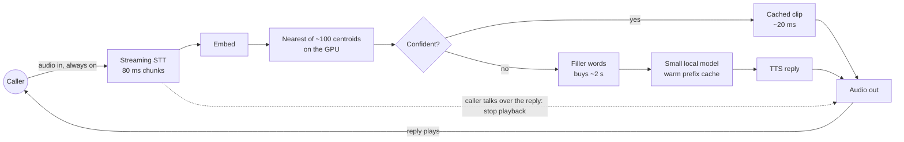

# Voice SDR (full-duplex)

A real-time voice sales agent tuned for latency. Sunset because of robocalling regulation.

Checked = built. Unchecked = specced, not built.

## Results

| Measured result |
|---|
| ~49 ms streaming speech-to-text per 80 ms chunk, live-tested from a Mac mic over an SSH tunnel |
| Objection tree of ~100 clusters, built from real cold-call objections |

## How it routes

## What was built and specced

- [x] **Twilio voice bridge**
  - → Jitter buffer on a strict 80 ms frame clock
  - → Voice-activity gating: silence goes in as zeroed audio, so the model doesn't hallucinate on hiss
  - → Streaming resampler (offline FFT resampling caused pre-echo in live audio)
- [x] **Full-duplex streaming speech-to-text**
  - → Kyutai Moshi 7B on a rented RTX 4090, chunked in 80 ms frames
  - → Live-tested by talking to it from a Mac mic over an SSH tunnel: ~49 ms per chunk
  - → Full duplex: it keeps listening while the reply plays, so the loop never pauses
- [x] **Objection tree (Matryoshka clustering)**
  - → Real objections embedded with BGE-large
  - → Clustered into 5 themes → 20 sub-themes → ~100 clusters
  - → Nemotron named and ranked the clusters
  - → Each cluster maps to objection → response pairs in NocoDB
- [x] **Response audio:** Kyutai TTS for the cached replies (XTTS as fallback)
- [ ] **Live routing:** classify each STT chunk against the tree as it arrives
- [ ] **Barge-in:** when the caller talks over a reply, stop playback at once and re-route the new chunk
- [ ] **Objection as a number**
  - → Each cluster gets an integer ID
  - → All ~100 centroid vectors held on the GPU: one matrix multiply, microseconds, no crawling the space
  - → At ~100 clusters brute force beats any index; FAISS (IVF or HNSW) only at millions
- [ ] **Coarse then fine**
  - → The Matryoshka tree narrows theme → sub-theme → cluster
  - → Matryoshka embeddings: compare on the first 64 dimensions, confirm on the full vector (worth it at thousands of clusters)
- [ ] **Clip cache:** every cluster ID points to a pre-rendered audio clip kept in GPU or RAM memory (~20 ms to play)
- [ ] **Template tier:** template plus TTS for close-but-not-exact matches (~200 ms)
- [ ] **Reasoning tier on a warm prefix cache**
  - → A small local model (a few billion parameters, quantized) on the same GPU
  - → SGLang radix-tree prefix cache over the fixed instructions, sales script and call so far
  - → Each turn only processes the new sentence: first token in roughly 100–200 ms (estimate, not measured)
- [ ] **Filler words and sentences**
  - → Standard fillers interleaved between cached clips
  - → Buys ~2 s while the reasoning tier finishes, so the seams aren't noticeable

## Lessons

- → Send raw binary audio frames, not JSON + Base64 (about 33% less overhead)
- → Offline tools like FFT resampling break live streams
- → Pick the GPU from the latency budget backwards

---

Part of my [GitHub profile](../README.md), chapter: Apps.
