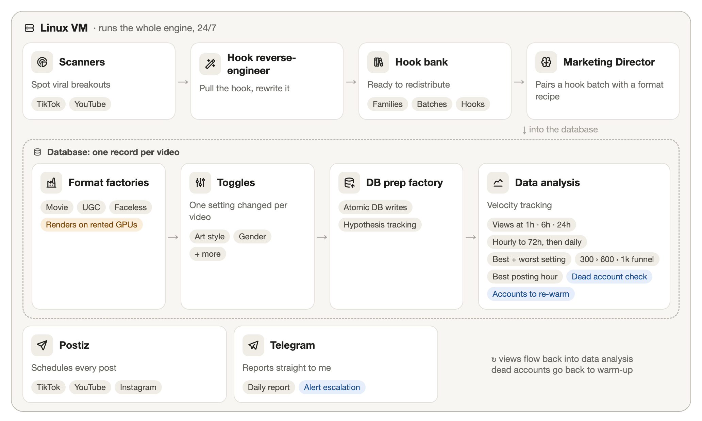

# Darwin: a content engine that runs video like a science experiment

**The goal:** turn viral videos into a scientific process. Make lots of small, controlled tests, and let the results decide what gets made next.

## How it works

1. **Scanners** read public TikTok and YouTube data (4.5 billion TikTok rows, 100M+ YouTube videos a month) and flag formats that are suddenly blowing up.
2. **Hook reverse-engineer** pulls the hook out of each breakout and rewrites it, so it's ready to use again.
3. **Hook bank** stores the rewritten hooks in families (like listicles), and each family in batches.
4. **Marketing Director** pairs a hook batch with a format recipe.
5. **Format factories** make the videos from that recipe: movie, UGC (person to camera) or faceless (voiceover and visuals).
6. **Toggles** inside each factory, like art style and gender, change one setting at a time, so each video in a batch is a clean test.
7. **DB prep factory** writes every video to the database in one safe step, with the hypothesis it tests, and gets it ready to post. One database holds every step from factory to results.
8. **Postiz and data analysis.** Postiz posts the videos to TikTok, YouTube and Instagram. A velocity tracker then checks each post's views every hour for the first 72 hours, then daily up to 30 days. For every setting it compares average views at 1, 6 and 24 hours, names the best and worst setting (only once a setting has enough posts), shows how many posts pass 300, 600 and 1,000 views, finds the best posting hour, and flags posts still at 0 views after 6 hours. Accounts whose posts keep sitting at 0 are flagged as dead and go back to warm-up. A daily report and any alerts go straight to me on Telegram. Any winner traces back to the exact hook, recipe and toggles that made it. Today I pick the next batch from those results myself; the next step is letting the engine shift toward winners on its own.

## Example

**Hook in:** "Top 3 habits that actually fix your head"

**Test batch out** (same hook, one setting changed each time):

| Video | Format | Visual style |
|---|---|---|
| A | Person-to-camera listicle (UGC) | Natural phone footage |
| B | Faceless voiceover | Poster illustration |
| C | Faceless voiceover | Watercolour |

If B beats A and C, the label says why: the faceless format in the poster style won on this hook. The next batch would test more hooks in that combination, still changing one setting at a time.

A second hook from the same family, "Top 3 habits that actually stop your brain from quitting", runs through the same batch. That checks whether the win came from the format or from the wording.

## What it's built on

- Open-weight video, image and voice models on my own rented GPUs, so each test video costs cents, not dollars.
- One database that tracks every hook, every video and every result.
- Automatic quality checks: a video that fails a check is never posted.

## What stays private

The exact settings and their options, the recipe for each format, the scanner queries, the prompts, and which hooks win. This page shows the machine, not the playbook.
