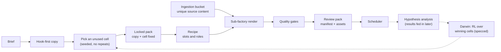

# Organic content engine: a k^p factorial design with every experiment traceable

A first-principles engine for organic content: an open creative space reduced to a finite grid of named axes, every cell run as a reproducible experiment and shipped as a locked pack whose outputs trace back to the cell that made them. Fully automated from brief to scheduled post.

## First principles

- **Derived from copywriting, hook first.** The words decide whether anything gets watched, so the copy is designed and locked before a single frame is rendered.
- **An atomic unit of the axes that matter.** Inspired by video-game character-creation screens: a handful of dials, each with a few named settings, that together define one piece of content. Pick the p axes that carry signal, give each k named levels, and the open space becomes k^p cells.
- **Every cell is an experiment.** Re-running a cell gives the same combination, so a result can be credited to the settings that caused it, not to luck.

## How it is organised

A Cartesian grid of cells on one side, a tree of sub-factories on the other. Each cell is routed to a recipe; each recipe fixes its slots (how many, and what role each plays) and the sub-factory that fills them. A new format is a new recipe on an existing branch, not new code.

- **Locked packs:** preview, reviewed checkpoint, then lock. Every piece of copy, plus translations into 10 languages, is fixed before render; the factory never rewrites the words.
- **Ingestion bucket:** sub-factories pull unique source content from a shared bucket, so cells differ in material, not only in wording.
- **Gates:** a prompt-trace audit must pass before anything publishes, and vision gates score every picture and clip (see [Decisions API gates](../backend/decisions_gates.md)).
- **Hypothesis analysis:** each batch is a pre-flight-checked test of named cells; result data feeds the analysis afterwards.
- **Darwin (specced, not deployed):** reinforcement learning over winning cells, so the grid shifts toward what works instead of sampling uniformly.

## Traceability

- The cell rides inside every queue row and asset request, so every output traces back to the exact settings that made it.
- Every important asset carries a manifest sidecar, from raw originals through per-product packs to a cloud mirror.

## Results

| Measured result |
|---|
| About 15 recipes; 5 core batch shapes plus 11 reaction shapes |
| Copy and translations into 10 languages locked before render |
| An 800-post rollout in about 9 days |

## Limits

- Today selection is seeded random without repeats; results do not yet reweight the grid. Darwin is the planned fix.

---

Part of my [GitHub profile](../README.md), chapter: Content engine.
